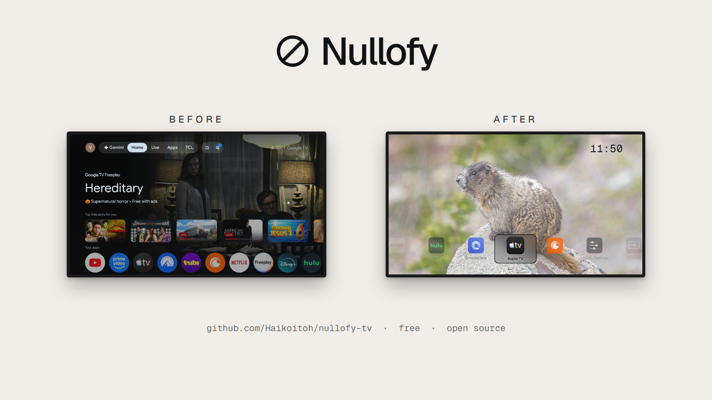
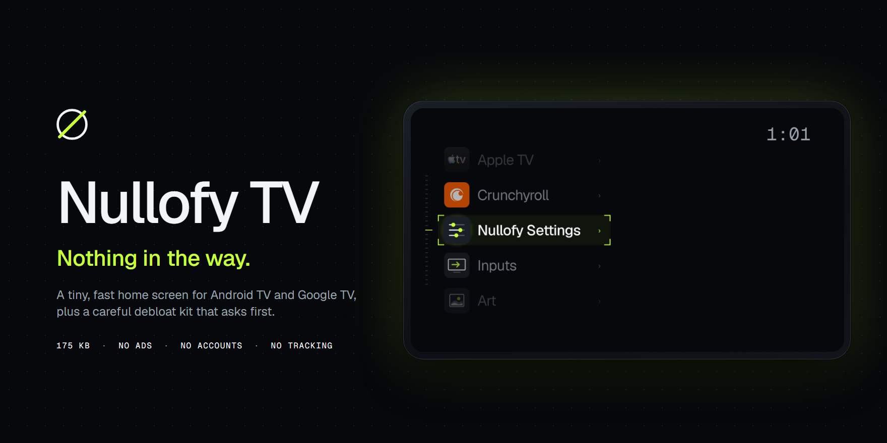
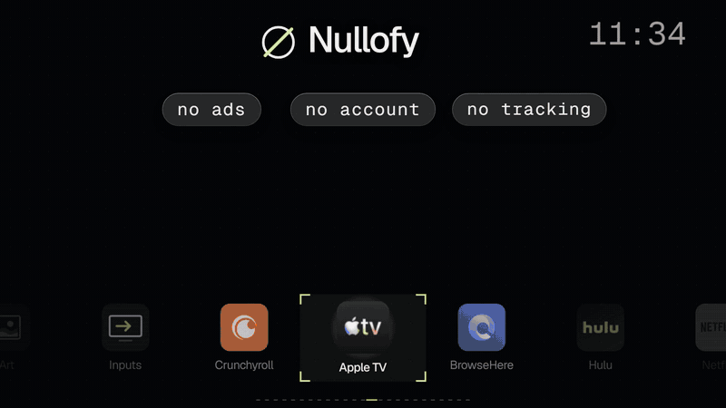
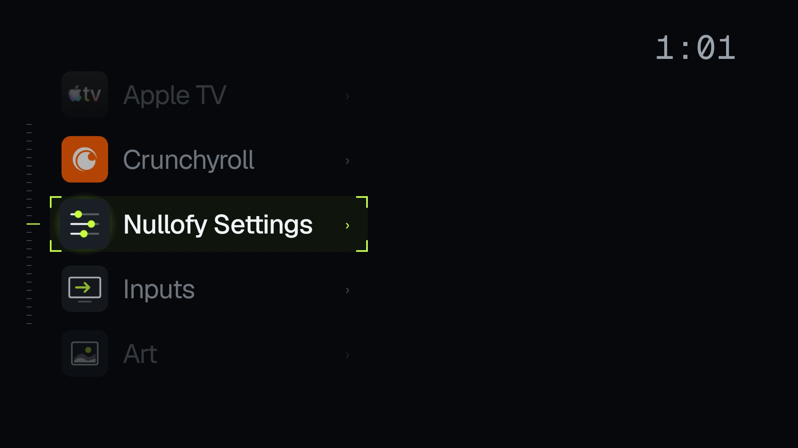
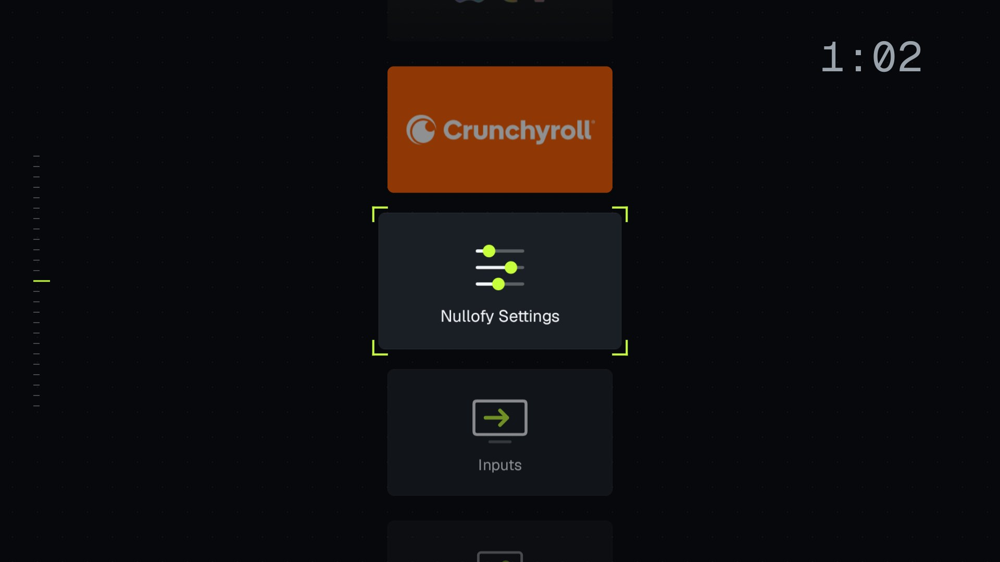
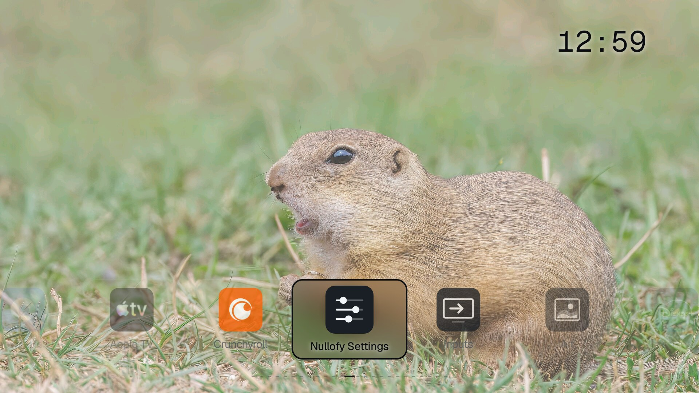
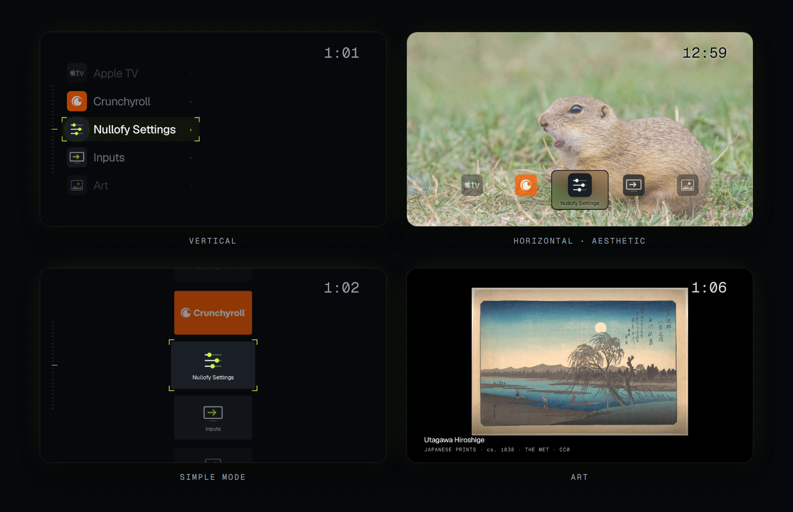

<div align="center">


# Nullofy TV

**Nothing in the way.** Your TV's home screen, minus the ads.

A small, fast home screen for Android TV and Google TV, plus a careful debloat kit. About 175 KB. No accounts, no analytics.

[](LICENSE)


[Install](#install) · [Is it safe?](#is-it-safe) · [Restoring](#restoring-your-tv) · [Build it yourself](#build-it-yourself) · [Contributing](#contributing)







</div>

Nullofy is a tiny home screen (the launcher) for your TV, plus a debloat kit that asks before it touches anything
and puts it all back when you want. It never uninstalls system apps, and one script undoes everything. Two ways to set it up: by hand with a few scripts,
or by pasting [`PROMPT.md`](PROMPT.md) into an AI coding assistant that can run commands (Claude Code, Codex,
Gemini CLI). Either way you stay in the loop: nothing past the Safe tier changes without your yes.

> **Status:** 1.0.0. Tested on a TCL Google TV (Android 14). Other Android TV / Google TV sets on Android 7.0+
> should work; please report yours (see [Contributing](CONTRIBUTING.md)). Not for Samsung (Tizen), LG (webOS)
> or the new Linux-based Fire TV (Vega OS).

**Contents:** [Why](#why) · [Looks](#looks) · [What you get](#what-you-get) · [The numbers](#the-numbers) · [Is it safe?](#is-it-safe) · [Install](#install) · [Restoring your TV](#restoring-your-tv) · [After a firmware update](#after-a-firmware-update) · [When something goes wrong](#when-something-goes-wrong) · [Build it yourself](#build-it-yourself) · [Privacy](#privacy) · [Questions people ask](#questions-people-ask) · [Contributing](#contributing) · [Licence](#licence)

---

## Why

TV home screens have turned into billboards: rows of recommendations, promoted shows, and services running in the
background that you never asked for. Nullofy starts from the other end. It is a home screen with your apps on it, a
picture behind them if you want one, and nothing else.

- **Your apps first.** The ones you use most sit in the middle, so Home → OK opens what you watch most.
- **Quiet by default.** No ads, no accounts, no analytics.
- **You stay in control.** The debloat kit takes a snapshot first, asks before each change, and one script puts
  everything back.

Built in the open, free, and MIT licensed. Reports from other TVs are welcome.

---

## Looks

| Dark, Vertical | Big tiles | Aesthetic, Horizontal | Art |
|---|---|---|---|
|  |  |  |  |

**Dark** is the default and **Day** is its light twin. **Aesthetic** puts a free-to-use picture behind your apps.
Pick a **Vertical** list or a **Horizontal** row, and icons with names or big banner tiles. The **Art** screen
shows the artist, the collection and the licence.

---

## What you get

**The launcher: Nullofy**

- **Small and light:** about 175 KB, about 30 MB of memory at Home (Google TV's own home used 137 MB on the same TV).
- **Private:** no ads, no accounts, no tracking, no analytics.
- **Your apps:** in a **Vertical** list (default) or a **Horizontal** row, as icons with names or as big banner tiles.
- **Most used:** the apps you use most sit in the middle, so Home → OK opens what you watch most. Or A–Z.
- **Continue watching:** an app's "watch next" rows (for apps that share them with Android).
- **Inputs:** HDMI ports with the device's name (HDMI-CEC) and whether it is on.
- **Looks:** **Dark**, **Day** and **Aesthetic**. Aesthetic puts a free-to-use picture behind your apps, changed
  every 1, 3, 5 or 10 minutes, with frosted-glass cards and an accent that can pick black or white from the picture.
- **Art:** a full-screen gallery of free-to-use (public-domain or openly licensed) paintings, photos and space
  pictures from The Met, the Art Institute of Chicago, Wikimedia Commons and NASA, with credits. **Safe Pictures**
  (on by default) skips most nudity, going by the pictures' own metadata; bloody pictures are never shown.
- **Screensaver:** a clock (and your own text) bouncing slowly round the screen, or Art.
- **Off Grid:** no network use at all (no pictures, no posters).
- **15 languages:** English, Spanish, French, German, Portuguese, Italian, Russian, Hindi, Marathi, Bengali, Tamil,
  Telugu, Japanese, Korean, Chinese (Simplified).
- **Burn-in care:** text that slowly breathes, a clock that shifts a few pixels, slow zoom on pictures.

**The debloat kit** ([`debloat/`](debloat/README.md))

- **Snapshot:** a copy of your TV's state before the first change.
- **Lists in three tiers:** per-model lists, Safe, Safe if unused, Ask (see [Is it safe?](#is-it-safe)).
- **Scan:** shows what a list would change, and which packages on your TV no list knows yet.
- **Restore:** every package back on, and the Home button and screensaver settings as they were.

What it does not do: no root, no system partition changes, no factory reset, no uninstalling of system apps,
nothing sent anywhere.

<p align="center">
  
</p>

---

## The numbers

| | Nullofy |
|---|---|
| Launcher size | about 175 KB |
| Memory at Home | about 30 MB (Google TV's own home: about 137 MB) |
| Network at idle | about 256 KB per 6 minutes with the debloat kit and Nullofy, against 813 KB on the stock setup |
| Oldest Android | 7.0 |
| Languages | 15 |

One run each on a TCL Google TV (Android 14), after a restart, with 6 minutes idle at Home. This is a measurement on
one TV, not a lab test, so yours will differ. Download is higher with Aesthetic on, because it fetches pictures.

---

## Is it safe?

Every change is a `pm disable-user`: the app stays installed, Android just stops running it. Turning it back on
is one command (or `debloat/restore.sh` for all of them). A factory reset also undoes everything.

| Tier | What is in it | What the kit does |
|---|---|---|
| **Safe** | Ads, promo apps, shop/hotel demo modes, ad services, log uploaders. Tested: nothing you use stops working. | Shows the whole group with a note per app, then asks once. |
| **Safe if unused** | ACR (the service that watches what is on your screen; recommended off), printing, Health Connect, Play Games, Google's screensaver. Each removes only the feature named. | Asks for each one, naming the feature. |
| **Ask** | Real choices (Chromecast, AirPlay, TalkBack, preinstalled streaming apps) and anything not yet tested on that model. | Asks for each one; untested ones are marked. |
| **Never** | [`debloat/keep.txt`](debloat/keep.txt): the TV's own home, setup, live TV and HDMI, settings, remote pairing, keyboard, Play Store and Play services, Bluetooth, Wi-Fi, Nullofy. | Refused, whatever a list says. |

Two things to know:

- **ACR** (`com.tcl.ttvs` on TCL) also carries T-Cast (casting from TCL's phone app) and the Alexa core, so it is
  in Safe if unused. Google Cast and AirPlay are separate apps.
- The kit never disables the TV's own home screen or setup wizard. On Google TV, turning off the stock home
  sends Home to a black recovery screen, so Nullofy takes the Home button instead (below).

---

## Install

### Before you start (on the TV)

1. **Developer options:** Settings → System → About → click **Android TV OS build** 7 times
   (older sets: Settings → Device Preferences → About → Build).
2. **Debugging:** Settings → System → Developer options → turn on **USB debugging** (and **Network debugging**
   or **ADB over network** if your set has it).
3. Note the TV's **IP address**: Settings → Network & Internet → your Wi-Fi network.

On your computer you need [Android platform-tools](https://developer.android.com/tools/releases/platform-tools)
(`adb`). If `adb` is not on your PATH, point the scripts at it: `export ADB=/path/to/adb`. To build the launcher you also need an Android SDK and a JDK (see [Build it yourself](#build-it-yourself)).

### Quick start with an AI assistant

1. Do [Before you start](#before-you-start-on-the-tv).
2. Open a terminal in this folder, start your assistant (for example `claude`), and paste the whole of
   [`PROMPT.md`](PROMPT.md), with your TV's model and IP address filled in at the top.
3. Accept **Allow USB debugging?** on the TV (tick **Always allow**).
4. Answer its questions. It takes the snapshot, shows you each tier and asks before each change, builds and
   installs Nullofy, and checks every step. Expect about 15–20 minutes.

### Doing it by hand

All commands run from this folder in a bash shell (Linux, macOS, or Git Bash on Windows).

```bash
export TV=192.168.1.50:5555        # your TV's IP address
adb connect $TV                    # accept the prompt on the TV, then check:
adb devices                        # must say "device", not "unauthorized"
```

**1. Snapshot** (changes nothing):
```bash
debloat/snapshot.sh
```

**2. See what would change** (changes nothing):
```bash
debloat/scan.sh debloat/lists/tcl-google-tv-14.txt
```
No list for your TV? Run `debloat/scan.sh` without a list: it matches your TV against every list and prints the
packages no list knows yet. Look those up before disabling anything, and please send what you learn.

**3. Debloat**, tier by tier, with a question for each step:
```bash
debloat/disable.sh debloat/lists/tcl-google-tv-14.txt --dry-run     # preview
debloat/disable.sh debloat/lists/tcl-google-tv-14.txt               # Safe as one group, then one question per app
debloat/disable.sh debloat/lists/tcl-google-tv-14.txt --tier safe   # only the Safe tier
```

**4. Build and install Nullofy:**
```bash
launcher/build.sh
launcher/install.sh
```
It installs the APK, names Nullofy the Home app, asks to turn on the **Home-button service**, and asks about the
screensaver. Then press Home on the remote: Nullofy opens.

**5. Wait a minute before restarting the TV.** A change made just before a restart can be lost on some sets.

---

## The Home button on Google TV

Google TV ignores the "default home app" setting and opens its own home on Home. Nullofy solves this with a
small **accessibility service** that watches only the Home key
and the stock home screen, and opens Nullofy instead. It reads no other keys, no screen content, no text.
Turn it off any time in Settings → Accessibility, or set **Default Home → TV default** in Nullofy's Settings.

---

## Restoring your TV

```bash
debloat/restore.sh
```

- Turns back on every package that is off now but was on at the snapshot.
- Puts the Home-button, accessibility and screensaver settings back as they were.
- Asks whether to uninstall Nullofy too.
- Packages you had turned off yourself before the snapshot stay off.

The snapshot lives in `~/.nullofy-tv/<tv-serial>/` on your computer (not on the TV) and is kept, so you can run
the kit again later. No computer? On the TV: Settings → Apps → See all apps → Show system apps → pick an app →
Enable.

---

## After a firmware update

Updates can turn apps back on. Run `debloat/scan.sh <your list>` again: anything back on shows up, and
`debloat/disable.sh` turns it off again (after asking).

---

## When something goes wrong

| What you see | What to do |
|---|---|
| `adb devices` says **unauthorized** | Accept "Allow USB debugging?" on the TV (tick Always allow). After a restart some TVs ask again. If no prompt shows: `adb kill-server`, then `adb connect $TV`. |
| Home opens Google TV's home | The Home-button service is off. Run `launcher/install.sh` again, or Settings → Accessibility → Nullofy Home button → On. |
| Home did nothing after an update of Nullofy | Open Nullofy once from the apps list, then press Home. |
| An app you use stopped working | `adb shell pm enable <package>`, or `debloat/restore.sh` for everything. Tell us which, so the list can move it to a safer tier. |
| No screensaver | Nullofy's screensaver starts after the TV's own idle time (Settings → System → Energy). On TCL it needs AUTO_START, which `install.sh` grants. |
| `INSTALL_FAILED_UPDATE_INCOMPATIBLE` | A Nullofy signed with another key is installed: `adb uninstall tv.nullofy.launcher`, then install again. |

---

## Build it yourself

There is no prebuilt APK yet: you build your own, signed with your own key (made on the first build).

1. Install a JDK 17 or newer and the Android command-line tools, then:
   ```bash
   sdkmanager "build-tools;34.0.0" "platforms;android-34" "platform-tools"
   export ANDROID_HOME=/path/to/android-sdk     # and JAVA_HOME if java is not on PATH
   ```
2. `launcher/build.sh` makes `launcher/out/nullofy.apk` (no Gradle; aapt2, javac, R8, apksigner).
3. Keep `launcher/nullofy.keystore` and `launcher/nullofy.keystore.pass` (git-ignored): updates must be signed
   with the same key.

Details of the launcher, its settings and its permissions: [`launcher/README.md`](launcher/README.md).

---

## Privacy

- Nullofy collects nothing and sends nothing about you. No account, no analytics, no crash reports.
- With network on, it fetches pictures from public, keyless museum and NASA APIs (https only), and posters for
  Continue Watching from the apps' own links. **Off Grid** turns all of that off.
- Settings stay in the app's private storage on the TV.

---

## Questions people ask

**Will this void my warranty or brick the TV?** No root and no system changes: only `pm disable-user`, which
Settings can undo too. The kit refuses the packages a TV needs to boot, show live TV or pair the remote.

**Why not uninstall the bloat?** Disabling frees the same memory and network, and can always be undone. An
uninstalled system app often can't come back without a factory reset.

**Does it block ads inside apps like YouTube?** No. It turns off the TV's own ad and tracking apps. For ads in
apps, look at a DNS filter (for example personalDNSfilter or a Pi-hole on your network).

**Why an accessibility service?** See [The Home button on Google TV](#the-home-button-on-google-tv).

---

## Contributing

New TV lists, fixes to tiers and translations are welcome: see [CONTRIBUTING.md](CONTRIBUTING.md).

---

## Licence

MIT, see [LICENSE](LICENSE). The Geist fonts are under the SIL Open Font License; see [NOTICE](NOTICE).
Pictures are not part of this repository: they are fetched at run time from their public sources and shown with
their credits.
